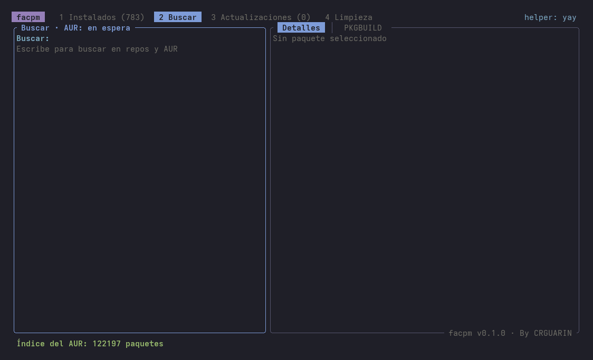
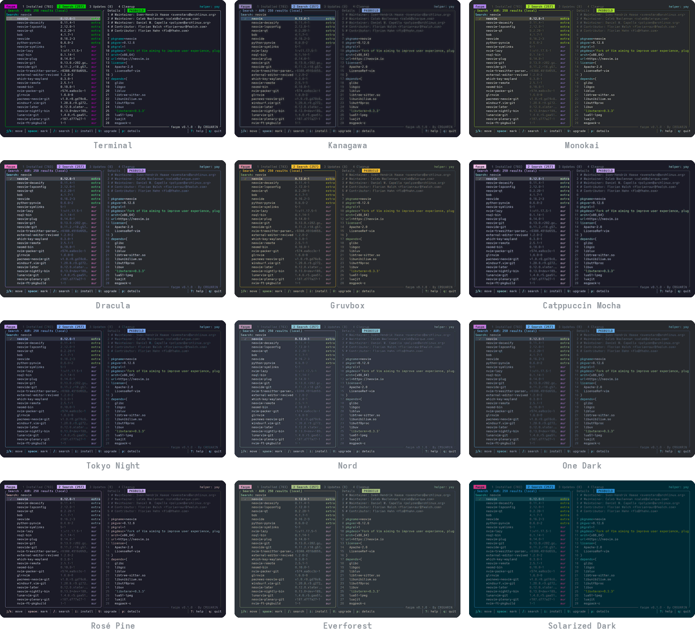

<div align="center">


### Like lazygit, but for your Arch packages.

Search the repos and the AUR as you type, read the PKGBUILD before you install,<br>
upgrade with your eyes open and reclaim gigabytes of cache, all from one keyboard-driven TUI.

[](https://archlinux.org)
[](https://www.rust-lang.org)
[](LICENSE)
[](https://github.com/CRGUARIN/facpm/actions/workflows/ci.yml)

[Why](#why-facpm) · [Install](#install) · [Keys](#keys) · [Themes](#themes) · [Configuration](#configuration)



</div>

## Why facpm

- **No more walls of `yay -Ss` output.** Results from the repos and the AUR show up as you type,
  ranked, from a local copy of the AUR index.
- **Know what you're about to run.** Every package has its PKGBUILD one key away,
  syntax-highlighted, for the AUR and the official repos alike.
- **Upgrade with your eyes open.** facpm flags AUR packages that changed maintainer since your
  last upgrade, were orphaned, flagged out of date or are new with few votes, and it shows the
  Arch news that needs manual intervention before you press `U`.
- **Get your disk back.** Orphans, old package versions, the AUR build cache: see how much each
  one frees, then clean it with one key.
- **Fits your setup.** It uses paru, yay or pikaur if you have one, plain pacman if you don't,
  and ships with 12 color themes.

## Install

From the AUR:

```sh
paru -S facpm   # or: yay -S facpm
```

From source (Rust 1.85 or newer):

```sh
git clone https://github.com/CRGUARIN/facpm
cd facpm
cargo build --release
sudo install -Dm755 target/release/facpm /usr/local/bin/facpm
```

`pacman-contrib` is recommended: facpm uses its `checkupdates` and `paccache`.

## Keys

| Key | Action |
|---|---|
| `1` `2` `3` `4` | Installed · Search · Updates · Cleanup |
| `j` `k` | Move |
| `/` | Filter or search |
| `space` | Mark several packages |
| `i` | Install |
| `u` | Uninstall |
| `U` | Upgrade the whole system |
| `p` | Toggle Details / PKGBUILD |
| `J` `K` | Scroll the right panel |
| `c` | Clean the selected task |
| `n` | Arch Linux news |
| `t` | Pick a theme |
| `?` | Every other key |
| `q` | Quit |

## Themes

Press `t` to preview them live. Your pick is saved for the next time.



## Configuration

```toml
# ~/.config/facpm/config.toml
theme = "kanagawa"
```

Themes: `terminal`, `kanagawa`, `monokai`, `dracula`, `gruvbox`, `catppuccin`, `tokyonight`,
`nord`, `onedark`, `rosepine`, `everforest`, `solarized`.

To force a specific helper, set `FACPM_HELPER` to `paru`, `yay`, `pikaur` or `pacman`.

## License

[MIT](LICENSE) © Cristian Alejandro Guarin Marin
